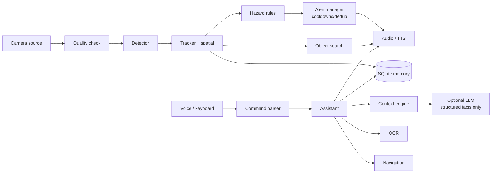

# AURA — Autonomous Understanding & Real-world Assistance

Open-source assistive intelligence for blind and visually impaired people: it looks through a camera, finds and describes objects, reads text, remembers where things were, and warns about obstacles — by voice, offline-first, and quiet unless something matters.

> **AURA is an aid, not a safety system.** It does **not** replace a white cane, a guide dog, or professional orientation and mobility training. It can miss hazards. It will **never** tell you a road, crossing, staircase or path is "safe". Read [docs/SAFETY.md](docs/SAFETY.md) before relying on any part of it.

This is an early prototype (v0.1). It runs today as a **Python application** (Linux, Raspberry Pi-class devices, desktop) with a camera, a keyboard or microphone, and speech output. There is **no Android app yet** — see [docs/ANDROID.md](docs/ANDROID.md) for what works on a phone and what does not.

## Goals

Independence, with honesty: useful information, delivered briefly, with its uncertainty stated. Design rules: voice-first, offline-first, privacy-first, modular, low-latency, no false confidence, and **safety decisions never depend on a language model**.

## What works today

Status key: ✅ implemented and covered by automated tests · 🟡 implemented but not verified against real hardware/services in the development environment · 🧪 experimental · 🗺️ planned (not implemented)

| Area | Status | Notes |
|---|---|---|
| Object detection (YOLOv8n ONNX, CPU) | ✅ | Real inference verified on a real photo (bus + people, ~25 ms/frame at 416px on a cloud VM; phones/Pi will be slower). 80 COCO classes. |
| Tracking, movement, no repeat announcements | ✅ | IoU tracker with stable IDs, appear/disappear/return, motion + approach estimate |
| Relative position (left/ahead/right, near/far) | ✅ | From bounding boxes. Distance is a **heuristic and always spoken as approximate** |
| Scene summaries (grouped, path obstruction) | ✅ | Not a flat object list; never implies "clear" when nothing is seen |
| Object finder ("Find my phone", "guide me", "cancel") | ✅ | Rate-limited guidance; never claims you reached the object |
| Deterministic safety engine | ✅ | Configurable risk scoring, 5 levels, cooldowns, dedup, escalation; no LLM |
| Persistent memory (SQLite) | ✅ | Current / recent / previous / stale / user-confirmed / unknown; delete, clear, retention |
| Context engine | ✅ | Decides what matters (safety > command > search > silence) |
| Command parser (rule-based) | ✅ | Works without any AI model |
| OCR / "Read this" | ✅ | Tesseract; verified on rendered text; low-confidence text is withheld, not guessed |
| Camera abstraction + failure handling | ✅ logic / 🟡 real devices | Reconnect, failure announcements tested with fakes; no physical camera was available in development |
| Optional AI assistant (OpenAI-compatible) | ✅ logic / 🟡 real servers | Off by default; structured facts only; cloud blocked unless allowed; tested against a fake HTTP session |
| Speech output | ✅ console · 🟡 espeak / pyttsx3 / Android Termux | Real audio engines were not testable in the sandbox |
| Speech input | ✅ keyboard · 🟡 Vosk offline microphone | Vosk is implemented but was not installed/tested |
| Outdoor navigation (OSM geocoding + OSRM foot routes) | 🟡 | Tested against mocked responses only; the live services were unreachable from the dev sandbox |
| Landmarks near you (Overpass) | 🧪 | Same caveat |
| GPS | 🟡 Termux GPS · ✅ fixed/none | |
| Distance sensors over serial (ESP32/Arduino) | 🟡 | Protocol + parsing tested with a fake serial port; no physical hardware |
| Local HTTP API (for an Android app) | ✅ | Token required, localhost by default |
| Door / stairs / key / wallet / curb detection | 🗺️ | The default COCO model has no such classes; AURA says so when asked |
| Depth estimation, SLAM, indoor positioning, automatic room recognition | 🗺️ | Abstractions exist (`DepthProvider`, `VisualLocalizer`); nothing behind them yet |
| Android app, wake word, vibration/haptics hardware, calling emergency contacts | 🗺️ | `HapticOutput` interface only; `emergency` reads your contact aloud but **cannot call** |

## Architecture



Safety path (top row) never touches the LLM. Details: [docs/ARCHITECTURE.md](docs/ARCHITECTURE.md).

## Install

```bash
git clone https://github.com/mahendiran-ship-it/Aura.git && cd Aura
bash scripts/setup.sh                 # venv + required packages + environment report
. .venv/bin/activate
python scripts/download_models.py     # YOLOv8n -> models/yolov8n.onnx (needs internet; see models/README.md)
python -m aura check                  # shows what is ready / missing
```

Optional: `sudo apt install tesseract-ocr espeak-ng` (reading text, speech) and `pip install -r requirements-optional.txt`. Full guide: [docs/INSTALLATION.md](docs/INSTALLATION.md).

## Run

```bash
scripts/run.sh                           # default camera (index 0), keyboard commands
scripts/run.sh --camera 1                # another webcam
scripts/run.sh --camera "http://PHONE_IP:8080/video"   # phone running an IP-camera app
scripts/run.sh --mode LOW_POWER          # Raspberry Pi / old phone
python -m aura analyze photo.jpg --read  # run the real pipeline on one photo
python -m aura parse "where did I last see my bag"
```

No camera? AURA still starts, says the camera is unavailable, and keeps memory, help and the other non-vision commands working.

## Voice commands

Speak or type (prefix "AURA," is optional). Say **help** to hear the list.

| Say | Does |
|---|---|
| describe / what is in front of me | scene summary / only what is ahead |
| find my phone · search for a bottle · where is the chair | live search with short guidance |
| guide me · cancel | direction to the target · stop searching |
| read this · read the sign · read only the important information | OCR (withholds low-confidence text) |
| remember this location · I am in the kitchen | name the room AURA stores memories under |
| where did I last see my bag | memory answer with time and freshness |
| remember that my keys are on the shelf | user-confirmed note (still dated) |
| memory history · forget my bag · clear all memory | review / delete (clear asks for confirmation) |
| navigate to *place* · where am I | outdoor navigation (internet + GPS source required) |
| repeat · stop talking · stop assistance · resume · status · emergency · quit | controls |
| is it safe to cross? | always: "I cannot reliably determine whether it is safe to cross. Please stop and use your established crossing method." |

Objects the default model cannot recognise (door, stairs, keys, wallet, glasses, signs…) are refused honestly; AURA offers to check memory instead.

## Configuration

`config/settings.yaml` (everything optional) and `config/safety.yaml` (risk weights, thresholds, cooldowns). Performance modes: `LOW_POWER`, `BALANCED`, `HIGH_PERFORMANCE` (inference size and frame skipping). Secrets go in environment variables only — see `.env.example`.

## Testing

```bash
pip install -r requirements-dev.txt
python -m pytest tests -q
```

At the time of this commit: **199 tests, all passing** in the development environment (includes real ONNX inference on a sample photo and real Tesseract OCR). Tests use fakes for cameras, microphones, speech engines, serial ports and network services — so passing tests do **not** prove it works with your physical hardware. Before committing, key safety behaviours (cooldowns, stale memory, crossing refusal, cloud blocking, OCR low-confidence) were also mutation-checked: deliberately breaking each made a test fail.

## Hardware

Minimum: any computer with Python 3.9+, 2 GB RAM, a camera (USB webcam, phone IP-camera stream, or video file) and speakers/headset. No GPU needed. Optional: ESP32/Arduino with HC-SR04 or ToF sensor ([docs/HARDWARE.md](docs/HARDWARE.md)). Wearable/smart-glasses and haptic support are interfaces only.

## Privacy

Local-first. No images, video or audio are saved or uploaded — ever by default (tested: processing writes no files). Memory stores only object name, rough position, room name, time and confidence, expires after 30 days (configurable) and can be deleted by voice. The optional AI assistant is **off by default**, receives only structured text facts (never frames), refuses non-local endpoints unless `ai.allow_cloud: true`, and announces when cloud AI is active. Logs contain events, not what you say.

## Known limitations

- It can miss hazards and misjudge distance; the camera sees only a narrow view. Detection of "nothing" is never evidence of safety.
- Monocular distance is a size/position heuristic. Risk scores are untuned heuristics, not validated against real-world data.
- COCO model: no doors, stairs, curbs, signs, keys, wallets. Dark/blurry views degrade results (AURA warns).
- Not field-tested with blind users. No user study, no clinical or regulatory validation.
- Real cameras, microphones, speech engines, GPS, live map services and serial sensors were not available in the development sandbox (see table).
- No Android app; Termux support is partial ([docs/ANDROID.md](docs/ANDROID.md)).
- The YOLOv8 weights are AGPL-3.0 (see [models/README.md](models/README.md)).

## Roadmap

See [docs/ROADMAP.md](docs/ROADMAP.md): field validation with orientation-and-mobility professionals and blind users first, then a door/stairs/curb model, depth, Android app, haptics.

## Contributing

Issues and PRs welcome, especially from blind and low-vision users and O&M instructors. Keep it honest: no simulated detections, no "safe" claims, every feature either real or labelled planned. Add a test with each change (`python -m pytest tests -q`), keep modules small and typed, and never commit secrets, photos, or memory databases (`.gitignore` blocks them).

## License

MIT for AURA code ([LICENSE](LICENSE)); model weights have their own licence.
