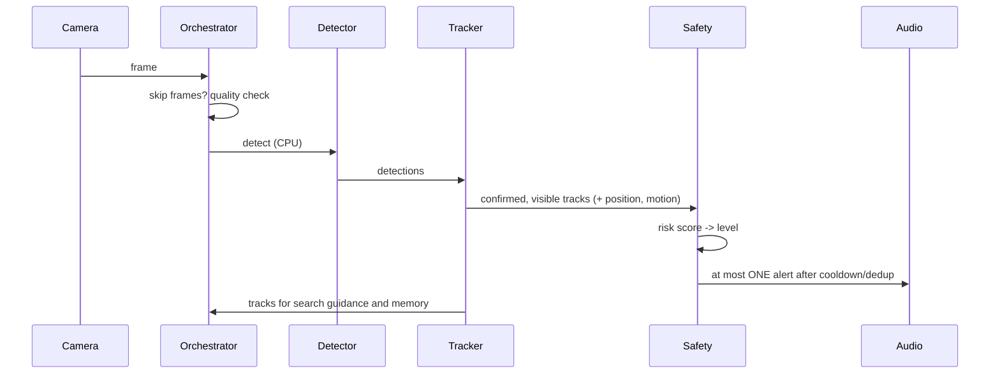

# Architecture

AURA is a set of small modules wired together by `aura/core/orchestrator.py`. Modules do not import each other's internals; shared types live in `aura/types.py`, and optional components are injected so tests (and future hardware) can replace them.

## Layout

```
aura/
  types.py                 BBox, Detection, TrackedObject, SpatialInfo, Alert, AlertLevel
  config.py                defaults < YAML < performance mode; secrets only from env
  core/
    orchestrator.py        the pipeline + command handling (threads live here)
    event_manager.py       tiny pub/sub (alert, command, frame.processed, camera.status)
    state_manager.py       locked shared state (camera ok? detector ready? paused? ...)
  vision/
    camera.py              CameraSource interface, OpenCVCamera, ImageFileCamera
    image_processor.py     resize/letterbox, quality check (dark/bright/blur), frame skipping
    detector.py            YOLOv8 ONNX on CPU (onnxruntime) + decoder/NMS
    tracker.py             IoU tracker, identities, motion/approach, lost/reappeared
    spatial_estimator.py   left/right/near/far heuristics; DepthProvider & VisualLocalizer hooks
    scene_analyzer.py      grouped summaries, path-obstruction wording
    object_search.py       "find X" state machine with rate-limited guidance
    ocr.py                 Tesseract, preprocessing, confidence gating
    labels.py              COCO labels, spoken aliases, list of unsupported objects
  safety/
    safety_rules.py        risk-score formula, level thresholds, fixed safety wording
    hazard_detector.py     tracks -> candidate alerts
    alert_manager.py       cooldowns, dedup, escalation, global rate limit
  memory/                  SQLite: observations (object memory), rooms, personal notes
  intelligence/
    context_engine.py      what matters now -> structured Context
    llm.py                 optional OpenAI-compatible client (local-first, cloud gated)
    assistant.py           command -> answer (deterministic; LLM only for free questions)
    response_generator.py  fixed honest wording
  audio/                   command_parser (rules), speech_output (TTS backends), speech_input, audio_manager
  navigation/              gps, map_engine (Nominatim/OSRM), route_guidance, landmark_engine (Overpass)
  sensors/                 DistanceSensor/HapticOutput interfaces, serial distance sensor
  interfaces/              cli.py, api.py (stdlib HTTP, token auth)
```

Differences from the suggested layout, on purpose: no `decision_engine.py` (prioritisation lives in `context_engine.py`, so there is one place to read); no separate `risk_assessment.py` (risk is in `safety/`, the only place it should be); `labels.py`, `ocr.py`, `llm.py`, `sensors/` were added.

## Frame pipeline



Key behaviours:

- **Quiet by default.** Nothing is spoken unless an alert passes the cooldown rules, a search has news, or the user asked.
- **Persistence.** A track must be seen `min_hits` times before it is announced or can alert; short flickers are ignored.
- **One alert at a time.** The most severe wins. A *worse* level for the same object breaks through its cooldown; CRITICAL ignores the global gap.
- **Degraded input is disclosed.** Dark/bright/blurry frames set a state flag; descriptions get a warning prefix and AURA warns once a minute at most.
- **Failure is announced.** Camera lost, detector missing or crashed → the user is told that hazard warnings are unavailable. Cameras are retried up to five times.

## Command path

`text → parse_command (regex rules) → Orchestrator (stop/repeat/pause/quit) or Assistant → spoken answer`. Free-form questions the rules do not recognise go to the optional LLM with a structured `Context`; with the LLM off or unreachable the user gets an honest message and every rule-based command still works.

## Safety vs. AI separation

| Decision | Made by |
|---|---|
| Obstacle / vehicle warnings, levels, cooldowns | `safety/` (pure Python, config-driven) |
| Crossing questions | Parser → fixed refusal text |
| Object positions, memory freshness | Vision + memory code |
| Free-form conversation ("what's the difference between…") | Optional LLM, given only a JSON of facts and a system prompt forbidding safety claims |

The LLM never receives images or audio and is never asked about safety. Even so, treat its answers as *conversation*, not facts about the world.

## Extension points

| Want to add | Implement | Register |
|---|---|---|
| New camera (Android bridge, BLE camera) | `CameraSource` | pass `camera=` to `Orchestrator` |
| Real depth (ToF, stereo, depth model) | `DepthProvider.distance_m` | `SpatialEstimator(depth_provider=...)` — proximity then becomes non-"uncertain" |
| SLAM / visual localisation | `VisualLocalizer.pose` | planned; interface only |
| Better detector (doors, stairs) | any YOLOv8-style ONNX + `labels=` | `ObjectDetector(..., labels=[...])` and update `labels.py`/safety weights |
| Distance sensor | `DistanceSensor.read` | `SensorHub([...])` → `Orchestrator(sensors=)`; alerts use `safety.yaml: sensor_distance_cm` |
| Vibration motor | `HapticOutput.pulse` | subscribe to the `alert` event topic |
| TTS engine | `TTSBackend` | `create_tts` |
| Speech recogniser | `SpeechInput.listen` | `create_speech_input` |

## Threads

One vision thread (`aura-vision`), one TTS worker (`aura-tts`), optional API server thread, and the main thread reading commands. Shared state goes through `StateManager` (locked); the track list is replaced atomically each frame.
